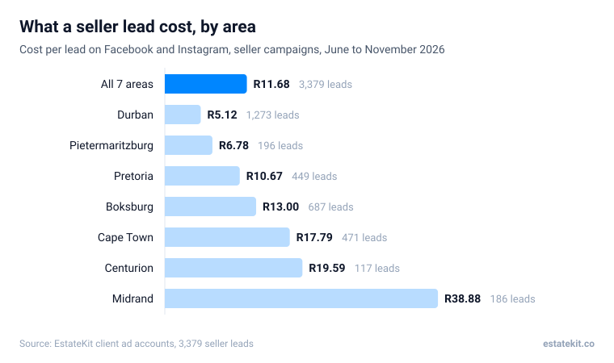

# Resources

Each `.md` file in this folder becomes a page at `/resources/<slug>`. It is
listed on `/resources` and on the author page, prerendered to static HTML
and added to `sitemap.xml` when the site builds. No component changes needed.

## File format

```md
---
title: How do Meta ads get seller leads for South African estate agents?
description: One or two sentences, 150 to 160 characters. Shown in Google and on /resources.
slug: how-meta-ads-get-seller-leads
publishedDate: 2026-11-12
updatedDate: 2026-11-12
shortAnswer: Two or three sentences that answer the title directly. Shown in the box at the top.
cta: call
---

Intro paragraph.

## A question-style heading?

Body text. Links to other pages work as normal Markdown: [results](/results).

## Frequently asked questions

### First question?

Answer.

### Second question?

Answer.
```

## The block at the end: `cta`

Optional. Picks the box that closes the guide.

| `cta` | Shows | Use for |
|---|---|---|
| `call` (or left out) | "Want this running for you?" and a Book a call button to /pitch | Pricing, comparisons, "is it worth it" guides |
| `training` | "Want to see the whole system first?" and a button to /training | Earlier-stage how-to guides |
| `tool` | Your own title, text and button, linking to a page on this site | Guides that lead into a calculator |

A `tool` CTA needs three more lines, plus an optional fourth:

```md
cta: tool
ctaHref: /tools/cost-per-lead-calculator
ctaTitle: What should a seller lead cost you?
ctaButton: Open the calculator
ctaText: Put in your area and commission and see what a lead is worth.
```

## Boxes, tables and videos in the body

**Common mistakes box.** Opens with `:::mistakes`, closes with a line of just `:::`.

```md
:::mistakes
- Waiting a day to call a new lead.
- Sending the same message to every lead.
:::
```

**Proof box.** Same idea. Anything after `:::proof` replaces the "Proof" label.

```md
:::proof Juani, Boksburg
Real result, with the real numbers.
:::
```

**Video.** One line: `:::video`, the Wistia media id, then an optional caption.
The id is the 10 characters at the end of the Wistia link.

```md
:::video z6oqli7c8o Juani on her first six weeks
```

**Images.** Put the file in `content/resources/images` (WebP is best; keep it
under about 200 kB), then add it on its own line. The text in quotes becomes the
caption, and the text in square brackets is the description for screen readers
and Google, so say what the image shows.

```md

```

Blur or black out names, numbers, emails and addresses in screenshots first.
The charts are drawn by `scripts/resource-charts.mjs`: update the numbers at the
top of that file and run `node scripts/resource-charts.mjs`.

**Cover image.** Optional. Shown at the top of the guide, on its card on
/resources and the homepage, and when the link is shared. Use a WebP or PNG
(not an SVG) so it works as a share image.

```md
image: images/funnel-ad-to-survey.webp
imageAlt: What the image shows
```

**Featured.** Add `featured: true` to the one guide that should lead /resources
and the homepage's guides section.

**Tables.** Normal Markdown tables. Wide ones scroll sideways on a phone.

```md
| Option | Cost a month | Who it suits |
|---|---|---|
| Run it yourself | Ad spend only | Agents with time to learn |
| Done for you | Ad spend plus a fee | Agents who want to just call |
```

Boxes and videos go in the body only, not in the FAQ.

## Rules the build checks

- The six fields in the example (all except `cta`) are required. Dates are `YYYY-MM-DD`.
- `slug` is lowercase words joined by hyphens. It is the URL, so don't change it once published.
- No `# ` headings in the body. The title is already the page's only H1. Use `## ` for sections.
- The last section must be `## Frequently asked questions`, with each question as a `### ` heading. These feed the FAQ schema.
- Every `:::mistakes` or `:::proof` box is closed with `:::`, and every `:::video` has a valid Wistia id.
- Bump `updatedDate` whenever you make a real change. It is shown on the page and in the sitemap.

If any rule is broken, `npm run build` stops and names the file and the problem.

## The author

The byline on every guide links to `/authors/kieran-ouseb`. The bio and
profile links (LinkedIn and so on) are in `src/config/schema.js` under `AUTHOR`.

Write without em dashes.
