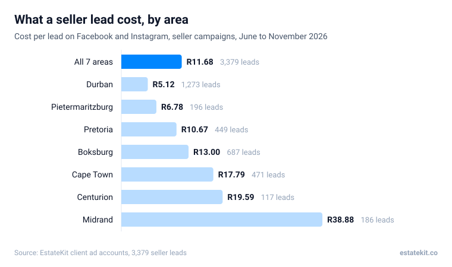
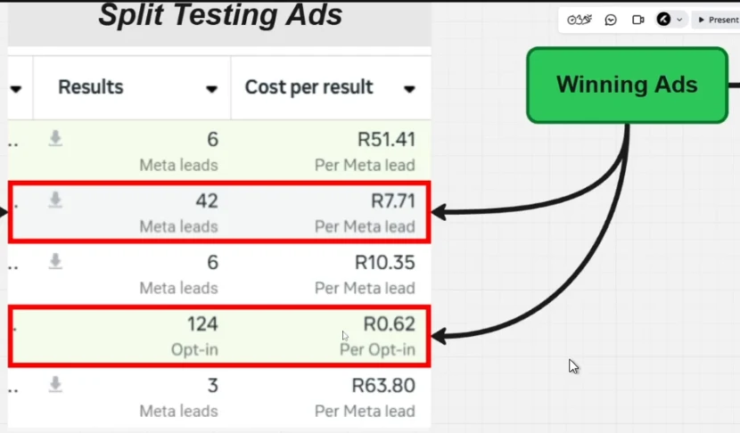

"What will the ads actually cost me?" comes up on almost every call we have with agents. Usually it's a guess, or a number from a course in another country. Here are the real numbers from the seller campaigns we ran for South African agents between June and November 2026, and what moves them up or down.

## What does a Facebook seller lead cost in South Africa?

R11.68 on average, across 3,379 seller leads in seven areas. Six of the seven areas came in under R20 a lead.

| Area | Ad spend | Seller leads | Cost per lead |
|---|---|---|---|
| Durban | R6,522 | 1,273 | R5.12 |
| Pietermaritzburg | R1,330 | 196 | R6.78 |
| Pretoria | R4,790 | 449 | R10.67 |
| Boksburg | R8,930 | 687 | R13.00 |
| Cape Town | R8,380 | 471 | R17.79 |
| Centurion | R2,292 | 117 | R19.59 |
| Midrand | R7,232 | 186 | R38.88 |
| **All seven** | **R39,476** | **3,379** | **R11.68** |

How we got these: the figures come straight from Meta Ads Manager for each agent's seller campaigns, valuation and seller ads only, with buyer and recruitment campaigns left out. Each area is one agent's campaign, so read a single area's number as one example, not a rule for that city.

## Why does one area cost seven times more than another?

Mostly the ads, not the area. Where you are plays a part, because more agents advertising nearby means more competition for the same homeowners. But the biggest swings we see happen inside a single campaign.

In our Boksburg campaign, three ads ran side by side on the same budget in the same weeks. One brought in leads at R8.19, one at R11.33 and one at R15.07. Two ads tested later cost R66.48 and R92.74 a lead and were switched off. Same agent, same suburb, same offer: the picture and the words made a ten times difference.

This is why we test several ads at once and keep moving money to the winners. It's also why a cost per lead quoted without the ads behind it doesn't tell you much.

## Is the ad budget included in an agency's fee?

Usually not, and it catches people out. One agent we spoke to had set aside R2,500 a month for marketing without realising the ad budget came on top of the service fee.

When you compare agencies, ask three things: how much ad budget they recommend, who pays Meta, and whether their fee changes when the budget does.

## How many leads will a daily budget get you?

Here's what the same budget gets at three different costs per lead. The middle column is our average.

| Daily budget | Per month | Leads at R5 | Leads at R11.68 | Leads at R20 |
|---|---|---|---|---|
| R50 | R1,500 | about 300 | about 128 | about 75 |
| R70 | R2,100 | about 420 | about 180 | about 105 |
| R100 | R3,000 | about 600 | about 257 | about 150 |

This assumes the cost per lead stays flat as you spend more. It usually creeps up, because Meta has to reach past the people most likely to respond. Use it to set expectations, not as a promise.

## What's a better number to watch than cost per lead?

Cost per booked appointment. A R5 lead who never picks up costs more than a R20 lead who books.

Of the 818 seller leads that agents moved past "new lead" in our dashboard, 91 became booked appointments: about 1 in 9. Across all 1,830 seller leads, including the ones agents never updated, it's about 1 in 20. At R11.68 a lead, that puts the ad cost of a booked valuation somewhere between R105 and R235.

Where you land in that range comes down to follow-up: how many of your leads actually get called, messaged and called again. [How the follow-up works](/resources/how-to-get-seller-leads-from-facebook-ads) explains what happens to the ones who don't answer.

## How long before you know what your leads really cost?

About a week. Costs jump around in the first few days while Meta learns who responds. Judge a campaign on at least 7 days of data, and change one thing at a time so you know what made the difference.

:::proof Lebogang
Lebogang's campaign brought in 65 leads at R9 each in its first three days, and 12 of them booked appointments within the week.
:::

:::video ahm5osiwq8 Lebogang on the first week

:::mistakes
- Budgeting for the agency fee and forgetting the ad spend.
- Switching ads off in the first few days because the cost per lead looks high.
- Spreading a small daily budget across several ad sets, so none of them get enough data to learn.
- Running the same ads for months until people stop noticing them.
- Comparing cost per lead between agencies without asking what counts as a lead.
:::

These are our clients' numbers for one period. Your costs will depend on your area, your ads and the time of year, and results vary by how quickly leads are followed up.

## Frequently asked questions

### What's a good cost per lead for seller ads in South Africa?

Anything under about R20 was normal across our campaigns this year: six of our seven areas came in under it. If you're paying more than R30, look at the ads before you blame the area.

### Is R5 a lead too good to be true?

Not necessarily. Our Durban campaign averaged R5.12 a lead over 1,273 leads. Cheap leads are only a problem if they don't pick up or don't own a home, so judge them by how many book, not by the price.

### Why did my cost per lead go up?

Usually because the same people have seen the same ads too many times. New pictures or a new angle normally bring it back down. If every ad got worse at once, check the form and the offer next.

### How much should I spend per day?

There's no magic number, but a small budget split many ways is the most common mistake we see. Put one daily budget on one campaign with a handful of ads, and let it run for a week before you change anything.

### Can EstateKit tell me what leads would cost in my area?

Yes. [Book a call](/pitch) and we'll walk you through what we've seen in areas like yours. See [results from agents we work with](/results) too.
