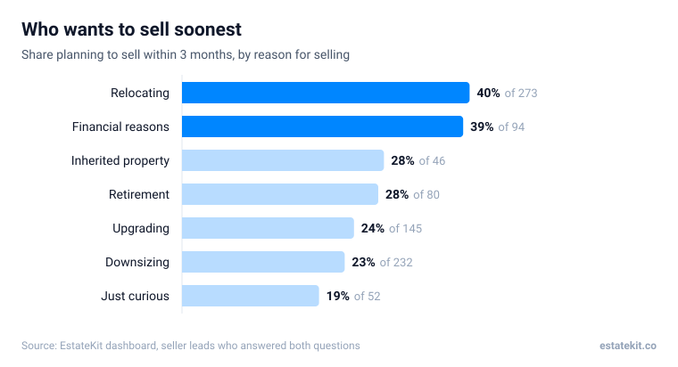
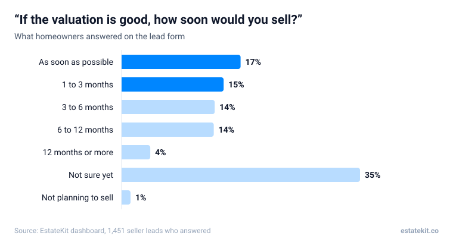
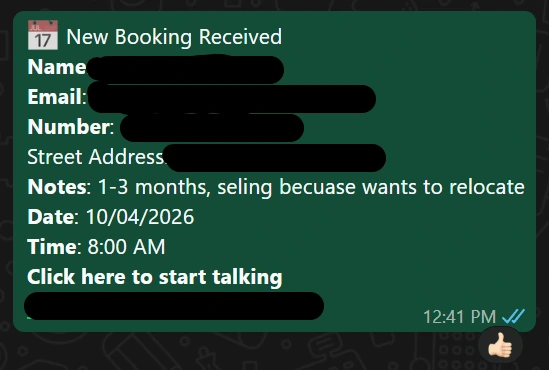

It's the most used seller offer in South African property ads, and agents on our calls often worry it's been done to death. The numbers say it still works, as long as you know who is answering it and what they want from you. Everything below comes from the 1,829 seller leads that came through our dashboard between June and November 2026, most of them from valuation campaigns.

## What is a free home evaluation ad?

An ad on Facebook or Instagram that offers a free estimate of what a home is worth. The homeowner taps it, gives their address and answers a few questions, and the agent follows up with the valuation.

It works because almost every homeowner wants to know what their place is worth, long before they're ready to sign anything. The valuation gives them a reason to talk to you now, instead of the day they decide to list with whoever knocks first.

## Who answers a free valuation ad?

Mostly people going through a change. Relocating (28% of our seller leads) and downsizing (24%) are the biggest groups, followed by upgrading (15%) and financial reasons (9%).

They're not equally ready, though. 40% of relocating homeowners and 39% of those selling for financial reasons planned to sell within 3 months. Only 23% of downsizers and 24% of people upgrading said the same.

So the reason they give on the form is the best clue you have about how soon they'll move, and it should change how you open the call. A relocating homeowner wants speed and certainty. A downsizer wants to know what they can afford next.

## How many free valuation leads are ready to sell?

About 1 in 3. Of 1,451 homeowners who answered "If the valuation is good, how soon would you sell?", 32% said as soon as possible or within 3 months. The biggest single answer was "not sure yet", at 35%.

"Not sure yet" isn't a no. It usually means "it depends on the number", which is exactly what you're offering.

## Should the form ask to visit the house?

Not yet. On the forms that asked whether the agent could come and see the home, 65% (123 of 190) answered "no, just give me a number". 28% said a visit was fine and 7% asked to be called first.

Homeowners asking for a valuation online want a figure, not a meeting. Call them, give a sensible range based on recent sales nearby, and explain that seeing the house is what turns the range into a real price. The visit is something you earn on the call, not something the form demands.

## What should a free valuation form ask?

Four or five questions, each with a job:

| Question | Why it's there |
|---|---|
| What's the full address of the property? | You need it for the valuation, and it filters out people who won't share it |
| If the valuation is good, how soon would you sell? | Separates this month from next year |
| What's the main reason you're thinking of selling? | Tells you how urgent it is and how to open the call |
| Is the home listed with an agent? | 94% of homeowners we asked said no, but you want to know before you call |
| Do you own the property? | Weeds out tenants and people asking on someone else's behalf |

Every extra question costs you a few leads and makes the ones you get better. If you're drowning in leads that never pick up, add a question. If you're getting too few, take one away.

## Doesn't every agent already run free valuation ads?

Lots do, which is why a vague one doesn't work. "Get a free valuation" over a stock photo looks like every other ad in the feed. What still works is being specific about the suburb, the type of home and the homeowner's situation.

The reasons above give you the angles. "Relocating and can't be in two places at once?" speaks to the biggest and most urgent group. "Is the house costing you more than it's worth?" speaks to the financial group, who are almost as ready to move. Both still end in a free valuation, but they don't look like everyone else's ad.

## What happens once a valuation request comes in?

The agent gets it on WhatsApp straight away, with whatever the homeowner wrote:

From there it's a phone call, not a sales pitch: confirm the address, ask what's behind the move, give a range and book the visit. [How SA agents get seller leads from Facebook ads](/resources/how-to-get-seller-leads-from-facebook-ads) covers the follow-up for everyone who doesn't answer the first time.

:::proof Sakhile, Pietermaritzburg
Three sole mandates in three weeks, all from sellers who made contact first rather than being cold called. [See Sakhile's results](/sakhile-results).
:::

:::video 5u31s8now8 Sakhile on three sole mandates in three weeks

:::mistakes
- Promising an exact price in the ad or on the form.
- Asking to visit the house before you've spoken to the homeowner.
- A generic ad that never mentions the suburb or the homeowner's situation.
- Writing off the "not sure yet" group after one call.
- Giving every lead the same pitch, whatever their reason for selling.
:::

Results vary by agent, area and how quickly leads are followed up. Nothing here is a promise of listings or income.

## Frequently asked questions

### Isn't the free valuation offer overused?

The offer is common, but most of the ads are vague. A valuation ad that names the suburb and speaks to a real situation, like relocating, still stands out. Our seller campaigns brought in leads at R11.68 on average this year, most of them from valuation ads. [See what leads cost by area](/resources/facebook-seller-lead-cost-south-africa).

### Do people leave fake numbers?

Some, but fewer than you'd expect. Agents marked 3.6% of our seller leads (66 of 1,830) as an invalid number.

### Should I give a price over the phone?

Give a range based on recent sales nearby, and explain that a visit is what turns it into a real price. Most homeowners on our forms asked for a number first, so giving one builds trust.

### How quickly should I follow up a valuation request?

The same day. Seller leads that agents logged a first call to within 24 hours booked an appointment about twice as often as those called later.

### What if they say they're just curious?

8% of our seller leads said exactly that. Give them the number and keep in touch: 19% of them still said they'd sell within 3 months.
