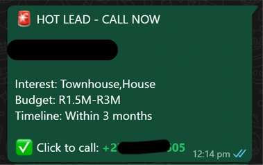
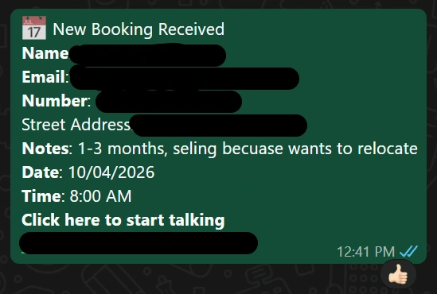
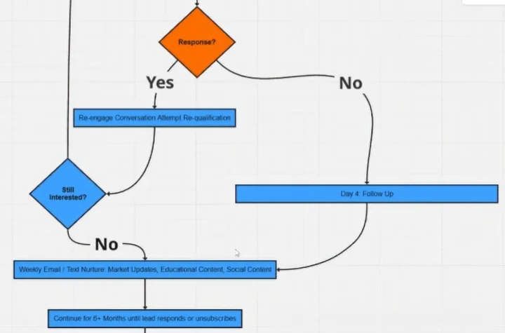
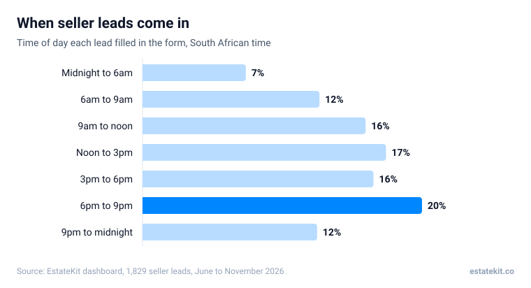
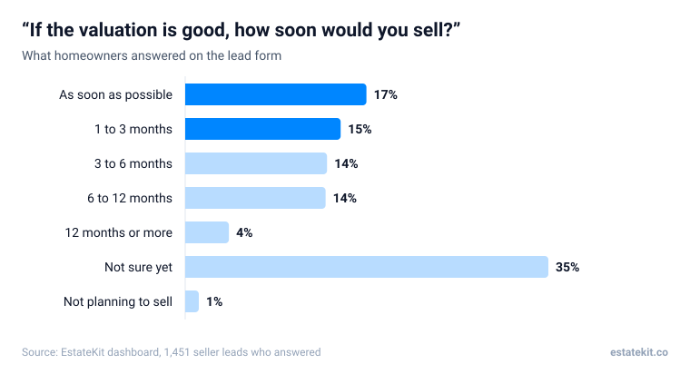

Cold calling and referrals aren't doing what they used to. On our calls we keep hearing the same story: one agent with 27 years in the business told us his sales had dropped from 15 to 18 a year down to 4 or 5. Facebook and Instagram ads are how we replace that pipeline for the agents we work with. The homeowner puts their hand up first, so the first call is one they asked for.

This guide walks through how the whole thing works, using real numbers from the 1,829 seller leads that came through our dashboard between June and November 2026.

## How do Facebook ads find homeowners who want to sell?

They mostly don't, at least not through targeting. The words and pictures in the ad do the finding.

Meta limits how narrowly you can target property ads. A campaign in the housing category can't target by age, gender or postcode, and the smallest area you can pick is a radius of about 24 km. So the ad itself has to do the sorting. When it names the suburb, the type of home and the homeowner's situation, the right people stop scrolling and everyone else keeps going.

That's why a vague "Get a free valuation" ad with a stock photo struggles, and "Thinking of selling your Moreleta Park home this year?" does better.

## What does the ad offer a homeowner?

Something they want before they're ready to list. Most of the time that's a free home valuation, because almost every homeowner wants to know what their place is worth long before they sign anything. A downsizing campaign, like the one in the picture at the top of this page, works the same way for older homeowners in homes that have become too big.

The form then asks why they're thinking of selling. Here's what 998 homeowners told us:

| Reason for selling | Share of seller leads |
|---|---|
| Relocating | 28% |
| Downsizing | 24% |
| Upgrading | 15% |
| Financial reasons | 9% |
| Retirement | 8% |
| Just curious about the value | 8% |
| Inherited property | 5% |
| Emigrating | 2% |
| Other | 1% |

The reason matters because it tells you how soon they're likely to move, and what to say when you call. We break that down in [how free home evaluation ads work](/resources/free-home-evaluation-ads).

## What happens after someone fills in the form?

The lead goes straight to the agent's WhatsApp, with their answers and a button to call them. No logging into a portal, no waiting for an email.

If the homeowner books a time to talk themselves, the agent gets a booking alert instead, with any notes they left:

Not everyone picks up the first time, and most aren't ready the first week. So the follow-up keeps going: if a lead goes quiet, they hear from the agent again on day 4, then get a message every week with market updates and useful content for at least six months, until they reply or unsubscribe.

## When do seller leads come in?

Mostly when you're not at your desk. 67% of our seller leads arrived outside Monday to Friday, 8am to 5pm. The busiest three hours were 6pm to 9pm, and 29% came in on a Saturday or Sunday.

This is the main reason the alert goes to WhatsApp. A homeowner who asks for a valuation at 7pm on a Sunday is thinking about it at 7pm on a Sunday.

## How many of these leads are ready to sell?

About a third. Of the 1,451 seller leads who answered the timeline question, 32% said as soon as possible or within 3 months. The biggest single answer was "not sure yet", at 35%.

The "not sure yet" group is where most agents give up too early. They're a big part of why the follow-up runs for months rather than days.

## How fast should you call a new seller lead?

The same day. Among the seller leads where agents logged their calls in our dashboard, those first called within 24 hours were about twice as likely to end up as a booked appointment: 17.5% (46 of 263) against 8.7% (8 of 92) when the first call came later.

Those are small numbers, and plenty of agents call from their own phone without logging it, so treat it as a direction rather than a law. But it matches what agents tell us: the homeowner who just asked for a valuation still remembers asking.

## What does it cost?

Across seven of our agents' seller campaigns from June to November 2026, a lead cost R11.68 on average. By area it ran from R5.12 in Durban to R38.88 in Midrand. The full breakdown, and what a daily budget gets you, is in [what Facebook seller leads cost SA estate agents](/resources/facebook-seller-lead-cost-south-africa).

## Does this work outside the big cities?

Yes. We've run seller campaigns for agents from Polokwane to the Garden Route, and in smaller towns as well as the metros.

## What does the whole system look like?

Five parts, and only one of them needs you:

| Part | What it does | Who does it |
|---|---|---|
| The ad | Offers homeowners in your area a free valuation | Runs on Facebook and Instagram |
| The form | Asks for the address, the reason and the timeline | The homeowner |
| The alert | Sends the lead and their answers to your WhatsApp | Automatic |
| The call | Turns the request into a valuation appointment | You |
| The follow-up | Keeps in touch with everyone who isn't ready yet | Automatic, for 6 months or more |

:::proof Juani, Boksburg
Juani's free valuation campaign in Boksburg brought in 687 seller leads at an average of R13 each between June and November 2026. The first six weeks produced 30 booked appointments, 11 listings and a closed deal, and one of those listings sold 8 days after it went on the market. [See Juani's results](/juani-results).
:::

:::video qgus1atule Juani on the first six weeks

:::mistakes
- Running a generic "free valuation" ad that never names the suburb.
- Only working leads during office hours, when two thirds of them arrive outside office hours.
- Calling once, getting no answer and marking the lead as dead.
- Asking to visit the house on the form, before you've spoken to the homeowner.
- Judging the campaign on its first three days.
:::

Results vary by agent, area and how quickly leads are followed up. Nothing here is a promise of listings or income.

## Frequently asked questions

### How soon do the first leads come in?

Often within days. Lebogang had 65 leads at R9 each in the first three days. Give a new campaign at least a week before you judge it, because Meta is still learning who to show it to.

### Is the daily ad budget per ad or for the whole campaign?

For the whole campaign. Meta spreads one daily budget across all the ads in it and moves more of the money to the ads bringing in the cheapest leads.

### Do I have to make videos?

No. Seller ads can run on photos and simple graphics. Video is a bonus, not a requirement.

### Will the homeowner already be listed with another agent?

Rarely. When our forms asked, 94% of homeowners (213 of 227) said their home wasn't listed with an agent.

### Why does the form ask questions instead of just a name and number?

The answers tell you who to call first and what to say. A homeowner relocating in the next month needs a different call from one who's just curious about the value.

### Can EstateKit run this for me?

Yes. [Book a call](/pitch) and we'll show you what it would look like in your area.
